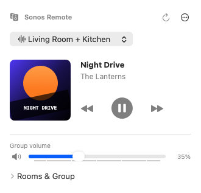
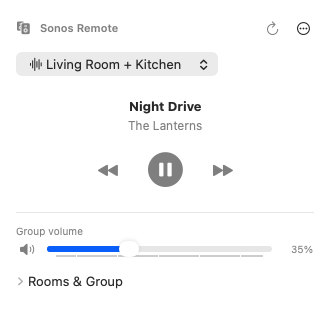
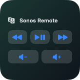
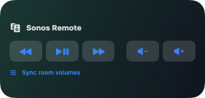
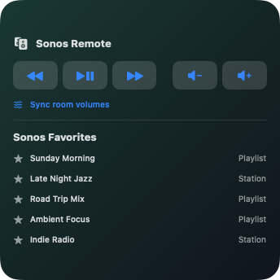

# Sonos Remote for macOS

A native menu bar remote for Sonos rooms and groups on your local network. An active room or group is selected on first connection when one is available.

- Play, pause, skip, mute, adjust group and room levels, and add or remove rooms.
- **Sync Room Volumes** sets each room to the current group level.
- Configure global shortcuts for volume, mute, play/pause, and track skipping.
- The Mac media keys work when macOS chooses Sonos Remote as its Now Playing app.
- Add small, medium, or large desktop widgets from **Edit Widgets**. The large size displays up to five Sonos Favorites.

## Preview

The previews below use sample rooms, tracks, and favorites.

| Menu bar · Artwork on | Menu bar · Artwork off |
| --- | --- |
|  |  |

| Small desktop widget | Medium desktop widget |
| --- | --- |
|  |  |

**Large desktop widget**



## Run locally

Requires macOS 14 or later on Apple silicon and a Mac on the same network as your speakers. Build the app with the instructions below, move it to Applications, and open it. In the first-launch setup window, choose **Connect**, then allow **Local Network** access if macOS asks. If discovery fails, enter a Sonos speaker’s IPv4 address and try again. Choose **Done** to finish setup.

To configure global shortcuts, open **… → Setup & Shortcuts** in the menu bar. Choose a modifier combination and a key for each action, or leave it **Off**. Shortcuts target the selected room or group and require no keyboard-monitoring permission. Turn on **… → Show Artwork** to display the current cover in the menu bar. Artwork is off by default.

To start Sonos Remote automatically when you sign in to your Mac, turn on **Launch at Login** under **… → Setup & Shortcuts**. It is off by default. If macOS requires approval, choose **Approve in Login Items Settings**.

## Network and privacy

The menu bar app, desktop widgets, and keyboard shortcuts control your speakers directly over your local network. They don’t use the Sonos cloud API or the Codex Sonos connection. Your Mac needs to be able to reach the speakers locally. Internet streams such as Sonos Radio still require internet access on the speakers themselves. When artwork is enabled, some cover images may load from a music provider over the internet.

The app stores the last speaker address and selection in local preferences and copies favorite titles and descriptions into a local shared widget cache. The downloadable bundle carries no speaker settings, favorite cache, or Sonos credentials.

## Build and install with ChatGPT or Claude

Use a coding agent running **locally on the Mac where you want to install the app**. Open a folder you can write to in [Codex](https://learn.chatgpt.com/docs/codex/cli) or start [Claude Code](https://code.claude.com/docs/en/quickstart) in that folder. You still need the [macOS and Xcode prerequisites](BUILD.md#prerequisites). A regular chat or cloud session can explain the commands, but you'll need to run them on your Mac.

Paste this prompt into your local coding agent:

```text
Build and install Sonos Remote on this Mac from
https://github.com/clonegitroot/sonos-remote-macos.

Clone the repository into the current folder, or use the existing checkout if
it's already here. Read README.md and BUILD.md. Check Apple silicon, macOS,
and the selected Xcode SDK before running ./build.sh. If a prerequisite is
missing, tell me how to set it up.

Verify the built app and embedded widget signatures. Copy the app to
/Applications and launch it. Ask before replacing an existing copy, and tell
me if macOS asks for Local Network access. Check that the menu bar app opens
and can see my Sonos system. If the widget is available, show me how to add
it from Edit Widgets.

Keep Gatekeeper enabled. Report any launch, signing, or widget limitation and
distinguish what you verified from what still needs testing.
```

The default build uses ad hoc signing. If the widget is missing from **Edit Widgets**, see [Signing and distribution](BUILD.md#signing-and-distribution) for the signed build path.

## Build

On the tested Mac, WidgetKit excluded the ad hoc build from the widget gallery. The ad hoc ZIP is a local menu bar test build. A widget-enabled distribution build requires separate signing and verification.

With Xcode selected and its command-line tools available, run:

```sh
./build.sh
```

The script creates `build/Sonos Remote.app` and `build/Sonos Remote.zip`. It signs the widget before the containing app and verifies the finished bundle. To use a local signing identity, set `SIGN_IDENTITY` to its name or fingerprint. See [Build notes](BUILD.md) for widget packaging and distribution details.

## License

Sonos Remote is free software licensed under the [GNU General Public License v3.0 only](LICENSE). This is an independent project and is not affiliated with Sonos.
